# 🐋 Cachalot Bay — Ocean Keeper

**A calm conservation tycoon about the real sperm whales of west Mauritius.**

🌊 **Website:** [oleksandr-mykhailenko.github.io/cachalot-bay](https://oleksandr-mykhailenko.github.io/cachalot-bay/)

  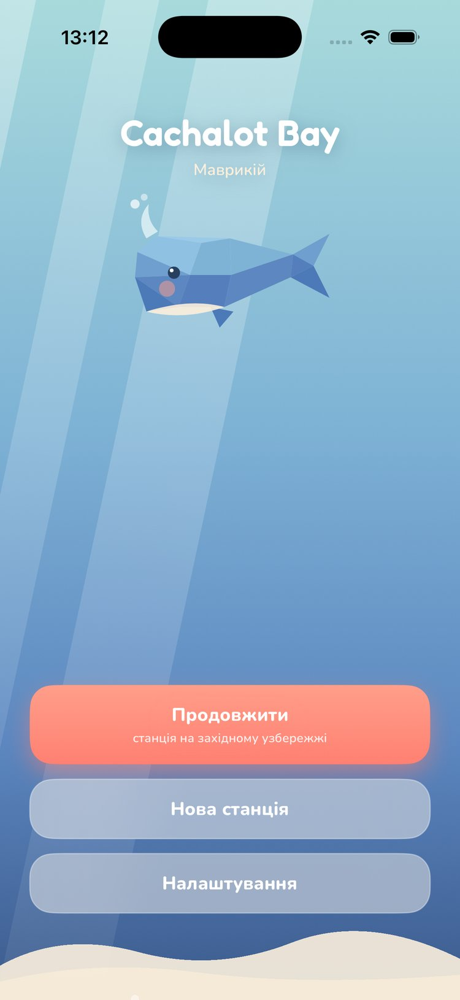
  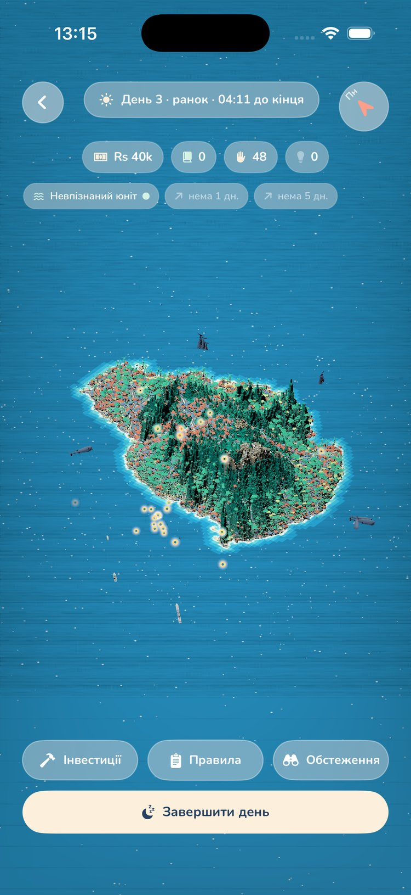
  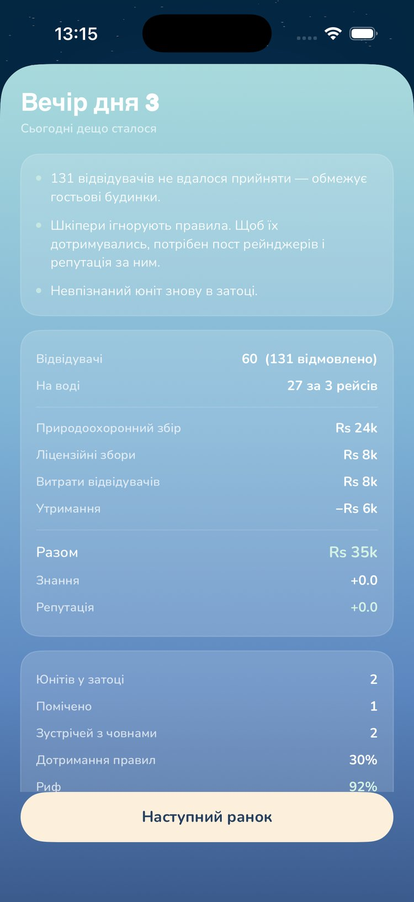

You run a small research station on the west coast of Mauritius. You manage boats, tour licences, rules, money and research. **You never control the whales.** They respond to what you do — and if you push them too hard, they leave.

> In the real ocean, humans are the variable. The game is built around that idea.

---

## Why this game exists

Most "nature" games hand you a fact card and move on. Cachalot Bay tries something different: **you learn by seeing consequences.** You find out why a 100-metre viewing distance matters because your whales stopped coming back.

The goal: by the end, a player can explain *why* Mauritius banned swimming with whales in 2023 — because they worked it out themselves.

**Tone:** calm, curious, hopeful. No guilt, no game-over screens. Whales never die from ordinary play — the consequence is absence, and they can be brought back.

---

## Built on real science

This is not a made-up tropical island. Mauritius has one of the best-documented sperm whale populations in the world, and nearly every system in the game maps to something real:

- 🔍 **101 individual sperm whales** were photo-identified off west and south-west Mauritius between 2008 and 2013. **19 were resident**, living in **three social units** and returning to the same waters for six years.
- 👩‍👧 The population is mostly **females with calves**; adult males are rarely seen here.
- 🗺️ The whales travel between **Mauritius, Réunion, La Pérouse Seamount and Rodrigues** — waters that form the **Mascarene Islands Important Marine Mammal Area**, home to 22 cetacean species.
- ⚖️ In **October 2023**, after a social-media-driven "whale-chasing" boom, Mauritius **banned swimming with whales** and set a **100 m minimum viewing distance**, with fines, possible prison terms and loss of licences for skippers.
- 📜 Sperm whales were listed as endangered in the US in **1970**, but the international moratorium on commercial whaling only took effect in **1986**.

Every fact shown in the game carries a citation to a real source — a scientific paper or an authority such as IUCN or NOAA. See [Sources](#sources).

---

## How it plays

The game runs in **days**, each one a 5–15 minute session.

1. **Morning — plan.** Build, set rules, send out survey and patrol boats.
2. **Day — the bay lives.** Whales move by their own logic. Tour boats operate under your rules. Things go right and wrong without you.
3. **Evening — the log.** Who was sighted, what you learned, what you earned, and what went wrong.

  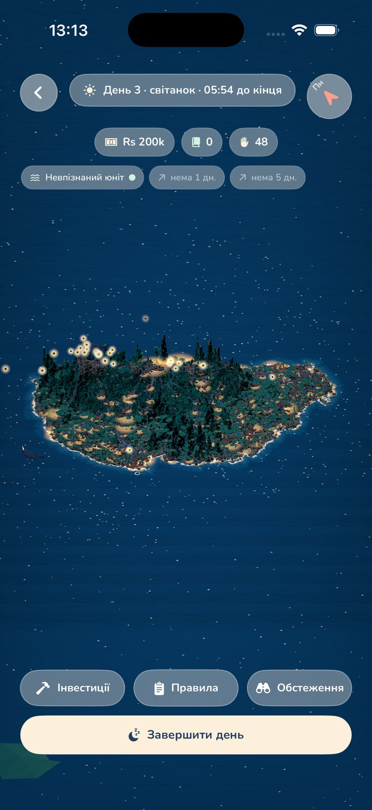
  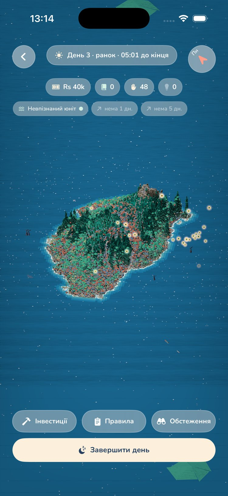
  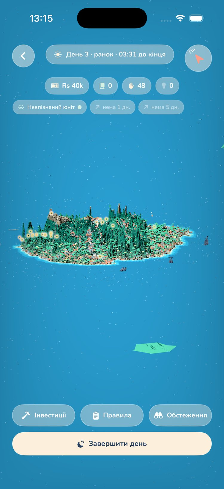

### The central tension: tourism

Tourism pays for everything. Unregulated tourism drives the whales away. You set the policy and live with it:

- how many tour licences to issue
- minimum approach distance (50 / 100 / 200 / 300 m)
- maximum boats per sighting
- swimming with whales — allowed or not
- seasonal closures

Strict rules → calmer whales, but less money and unhappy operators.
Lax rules → money now, empty water later.

  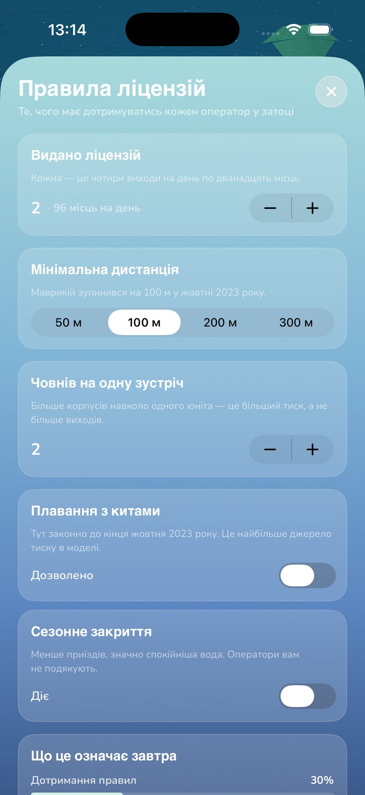
  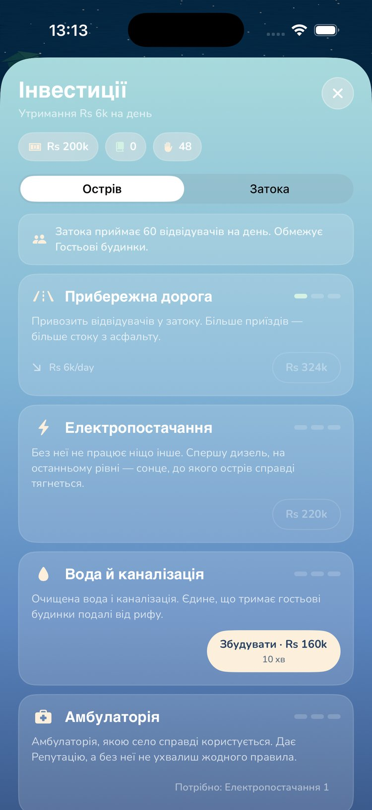
  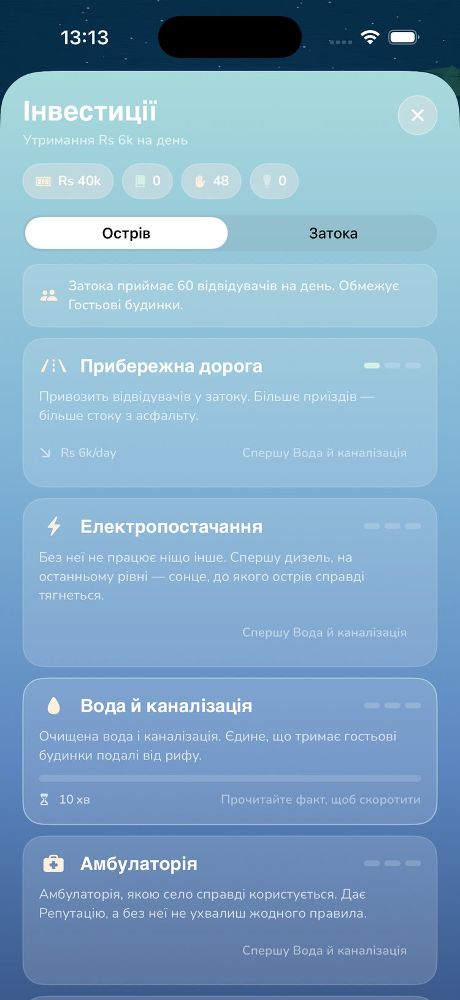

### Three resources — and whales are not one of them

| Resource | Earned by | Spent on |
|---|---|---|
| **Funding** | Tour licence fees, grants, donations | Boats, equipment, construction |
| **Knowledge** | Surveys, photo-ID, acoustics | Unlocking research and understanding |
| **Standing** | Jobs, education, visible results for the island | Passing rules — the community has to back them |

Whales are never a number that goes up. They are individuals with names, families and memory of how they were treated.

### Photo-ID and the catalogue

Every whale starts as an unknown silhouette. Build a research station, photograph them, and they become *someone* — part of a social unit you can recognise when it returns. This mirrors the real photo-identification work done off Mauritius.

### Facts you earn

Facts unlock when the game has just shown you why they matter. Reading one also speeds up construction.

  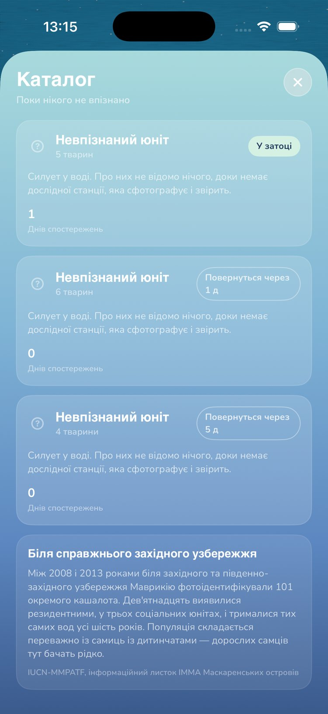
  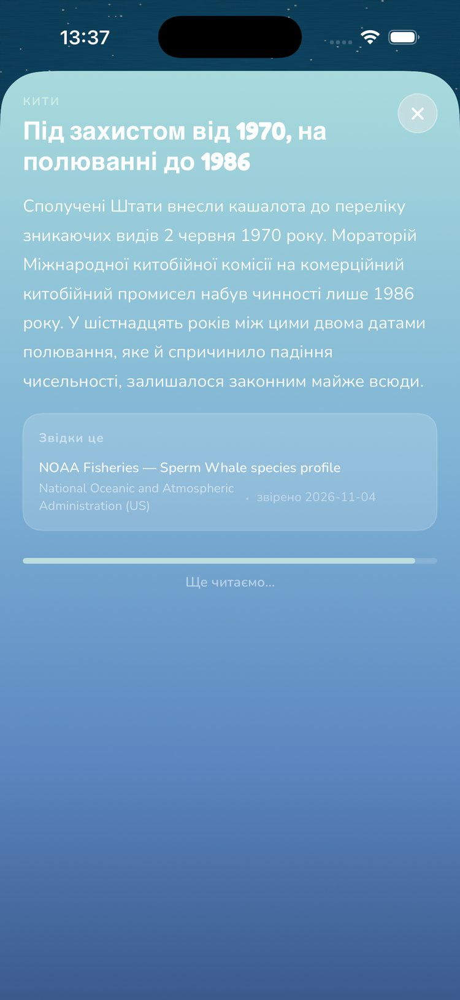

---

## What's coming

- Hydrophone array — hear whales you can't see, and *see* ship noise on the map
- Mooring buoys, ranger post and patrol boat, visitor centre
- Threats as lessons: boat disturbance, vessel strike, underwater noise, entanglement, plastic
- A knowledge tree: deep foraging, dive physiology, codas and dialects, calf-rearing
- Expansion beyond one bay to Réunion, La Pérouse Seamount and Rodrigues on a 3D globe

---

## Built with

- **Swift** and **SwiftUI** — iOS 17+
- **SceneKit** — the isometric island and the globe
- **SpriteKit** — ambient menu scenes
- **SwiftData** — local saves, no backend
- Low-poly art style; 3D assets from CC0 [Kenney](https://kenney.nl) kits

Screenshots above show the Ukrainian localization.

---

## ☕ Support the project

Cachalot Bay is an independent project. If you'd like to see more whales, more islands and more real science in it, you can buy me a coffee:

Any bank card, Apple Pay or Google Pay. Starring the repo and sharing the [website](https://oleksandr-mykhailenko.github.io/cachalot-bay) helps too.

---

## Sources

- [Mascarene Islands and Associated Oceanic Features — IMMA factsheet](https://www.marinemammalhabitat.org/factsheets/mascarene-islands-associated-oceanic-features/) — IUCN Marine Mammal Protected Areas Task Force
- [Underwater photo-identification of sperm whales (*Physeter macrocephalus*) off Mauritius Island](https://archimer.ifremer.fr/doc/00779/89069/)
- [Kin relationships in cultural species of the marine realm: a matrilineal social group of sperm whales off Mauritius island](https://www.ncbi.nlm.nih.gov/pmc/articles/PMC8074673/)
- [Mauritius clamps down on social media "whale-chasing" craze](https://www.rfa.org/english/news/environment/whales-watching-china-mauritius-tonga-10052024092941.html) — RFA, Oct 2024
- [Sperm Whale species profile](https://www.fisheries.noaa.gov/species/sperm-whale) — NOAA Fisheries

---

<i>Made by <a href="https://github.com/oleksandr-mykhailenko">Oleksandr Mykhailenko</a>.</i>

